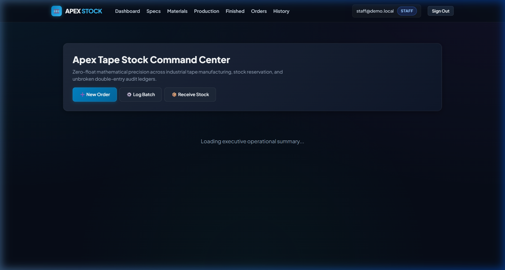
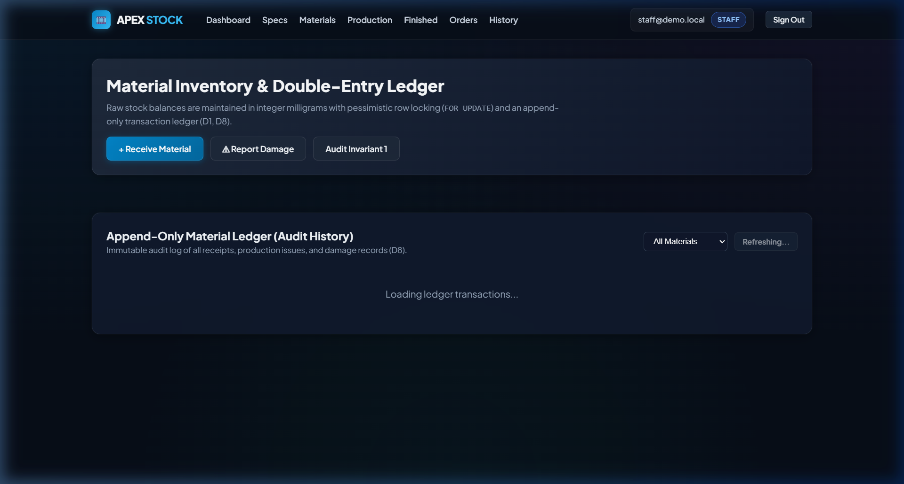
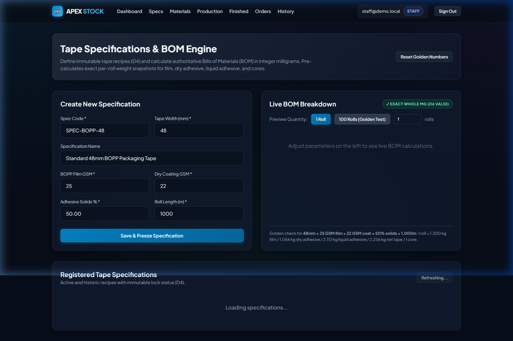
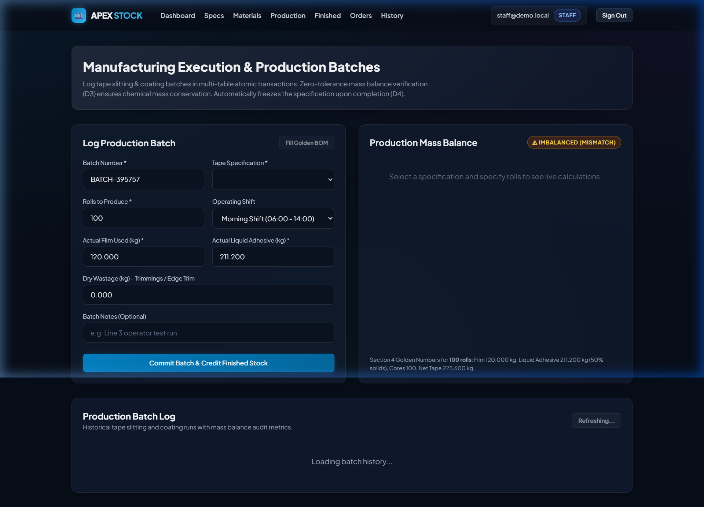
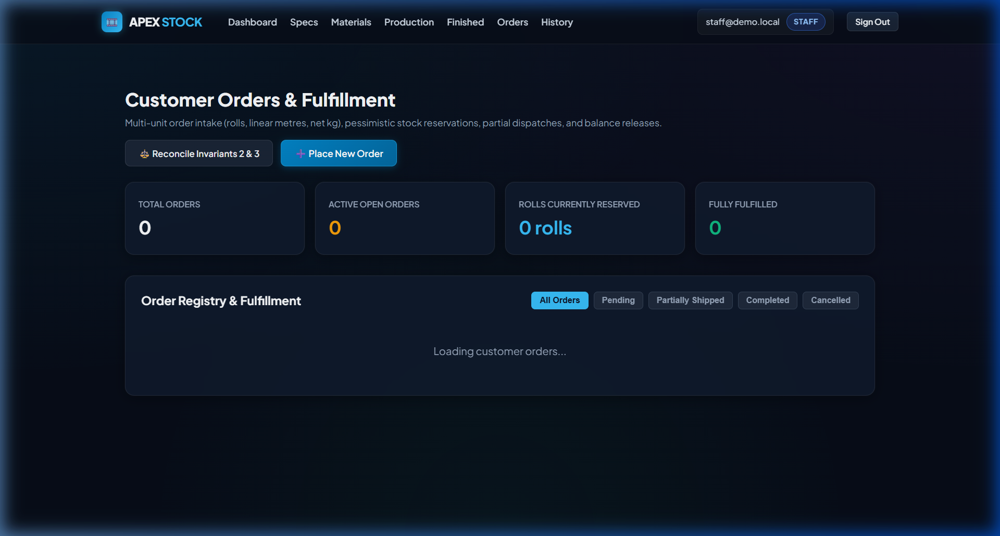
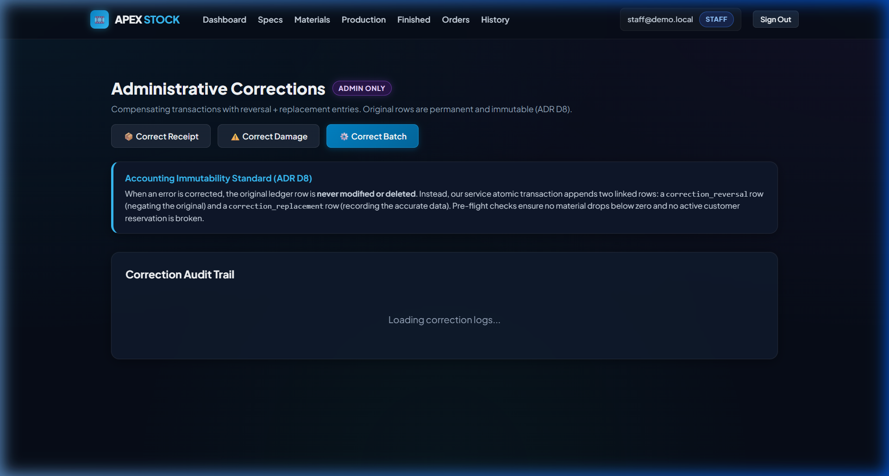
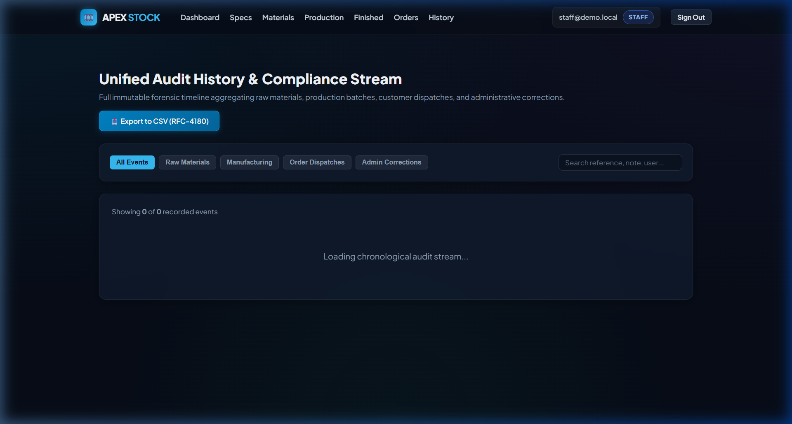
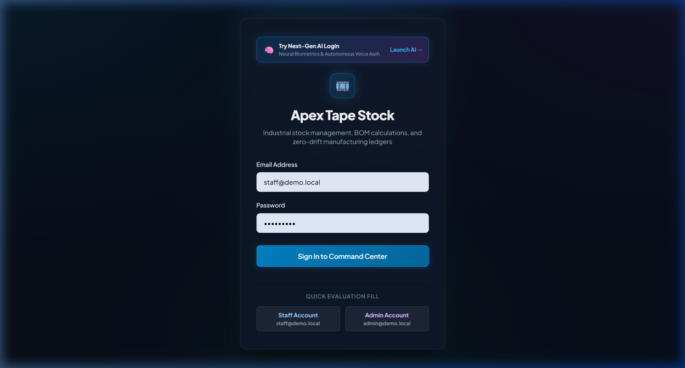

# Apex Tape Stock Management System

An industrial-grade inventory, BOM calculation, production balance, and order fulfillment system designed for adhesive tape manufacturing.

Built with **Next.js 14 (App Router)**, **React 18**, **MySQL 8 (InnoDB)**, and **Vitest**.

---

## 1. Quick Overview

Standard inventory applications rely on floating-point arithmetic and mutable `UPDATE` operations. In industrial tape coating, this produces stock drift and destroys audit trails.

**Apex Tape Stock** solves this through an accounting-grade architecture:
- **Zero Floating-Point Math**: All weights are stored and calculated as integer milligrams (`BIGINT`), and percentages as basis points (`50.00% = 5000 bp`).
- **Zero-Tolerance Mass Balance**: Production coating runs enforce exact conservation of mass:
  $$\text{Film (mg)} \times 10,000 + \text{Liquid Adhesive (mg)} \times \text{Solids (bp)} = (\text{Net Tape (mg)} + \text{Waste (mg)}) \times 10,000$$
- **Dual-Defense Spec Immutability**: Specs referenced by production are permanently locked by application guards and MySQL triggers (`SQLSTATE '45000'`). Changes create cloned versions ($N+1$).
- **Append-Only Immutable Ledgers**: Material and finished goods transactions are insert-only. Administrative corrections append compensating reversal and replacement entries.
- **Pessimistic Concurrency**: Stock reservations use `SELECT ... FOR UPDATE` in deterministic key order, eliminating deadlocks and over-allocation.

> 📖 **Deep Dive Documentation**: For step-by-step mathematical derivations, formula explanations, and complete feature walkthroughs with real inputs, see **[`OPERATIONAL_GUIDE.md`](./OPERATIONAL_GUIDE.md)**.

---

## 2. Visual Interface & Working Demos

### 1. Executive Dashboard Command Center
Real-time operational summary featuring raw material stocks, warehouse balances, order pipeline metrics, and continuous system invariant health monitoring.


---

### 2. Raw Materials Inventory & Double-Entry Ledger
Complete ledger tracking for BOPP film, liquid adhesive, and paper cores with row-locked atomic deductions, shortage guards, and live Invariant 1 reconciliation.


---

### 3. Specifications & Live Interactive BOM Calculator
Canonical `SPEC-BOPP-48` specification management with real-time multi-roll BOM scaling, integer milligram derivations, and dual-layer locked spec immutability.


---

### 4. Production Execution & Zero-Tolerance Mass Balance
Coating batch execution enforcing exact chemical mass balance. Rejects imbalanced inputs with exact shortage/surplus values; commits balanced runs atomically across five tables.


---

### 5. Customer Orders Pipeline & Concurrency-Safe Reservations
Commercial order processing with multi-unit conversion (rolls, metres, kg), whole-roll alternative suggestions (e.g. $1,500\text{ m} \to 1,000\text{ m}$ or $2,000\text{ m}$), pessimistic inventory locking, partial dispatch, and cancellation release.


---

### 6. Administrative Compensating Corrections
Regulatory audit-grade corrections implementing the Reversal + Replacement compensating ledger pattern (ADR D8) with pre-flight negative stock simulation and mandatory rationale sign-offs.


---

### 7. Unified Audit Trail Stream & RFC-4180 CSV Export
Chronological event fan-in aggregating material transactions, production runs, finished goods movements, and administrative adjustments with filter chips and 1-click CSV export.


---

### 8. Classic Authentication Portal
Dual-role cryptographic authentication using salted bcrypt hashing and SHA-256 session hash storage, featuring 1-click evaluation autofill buttons and AI login discovery banner.


---

### 9. Next-Gen AI Neural Authentication Portal (`/ai-login`)
Autonomous cognitive security gateway featuring an interactive HTML5 neural particle mesh canvas, real-time telemetry HUD, and 3 AI authentication pathways:
- **Neural Biometrics**: 468-point 3D facial landmark scanner HUD with liveness verification and SHA-256 token minting.
- **AI Voice & NLP Autonomous Sign-In**: Natural language intent parser with acoustic equalizer visualizer.
- **Quantum Vault**: Real-time cryptographic entropy radar and behavioral bot-detection telemetry.


---

### 10. Live Biometric Face & Optical Acquisition HUD
Multi-phase biometric verification tracking optical sensor calibration, 3D landmark mesh mapping, and zero-knowledge identity matching against the Apex manufacturing ledger.


---

## 3. Demo Accounts

The login portals (`/login` and `/ai-login`) include **1-Click Quick Fill** and **Neural Biometric Persona** buttons for immediate evaluation:

| Role | Email | Password | Primary Capabilities |
|---|---|---|---|
| **Staff** | `staff@demo.local` *(or `staff@apex.com`)* | `Staff123!` *(or `password123`)* | Receive materials, log production, calculate BOMs, create customer orders, dispatch shipments, cancel orders. |
| **Admin** | `admin@demo.local` *(or `admin@apex.com`)* | `Admin123!` *(or `password123`)* | All Staff permissions, plus: compensating corrections (receipts, damages, batches) with mandatory reasons, and invariant reconciliation audits. |

---

## 4. Reference Specification (`SPEC-BOPP-48`)

The canonical benchmark specification registered in the database seed:
- **Dimensions**: $48\text{ mm}$ width $\times$ $1,000\text{ m}$ length ($48\text{ m}^2$ area)
- **Substrate**: 25 GSM BOPP Film ($1.200\text{ kg}$ / roll)
- **Adhesive**: 22 GSM dry coat at 50.00% solids ($2.112\text{ kg}$ liquid adhesive / roll)
- **Net Roll Weight**: $2.256\text{ kg}$ tape + 1 paper core
- **100-Roll Batch**: $120.000\text{ kg}$ film + $211.200\text{ kg}$ liquid adhesive + $100\text{ cores} \to 100\text{ finished rolls}$ ($225.600\text{ kg}$).

---

## 5. Setup & Running Locally

### Prerequisites
- **Node.js**: v18.17+ or v20+
- **MySQL 8** (or Docker)

### Installation Steps

```bash
# 1. Install dependencies
npm install

# 2. Configure environment
cp .env.example .env

# 3. Start MySQL (Option A: Docker Compose)
docker compose up -d

# 4. Run schema migrations (001 to 006 with triggers and constraints)
npm run db:migrate

# 5. Seed initial data (users, materials, customers, SPEC-BOPP-48)
npm run db:seed

# 6. Execute automated test suite (102 tests across 12 suites)
npm test

# 7. Start the application
npm run dev
```

Open [http://localhost:3000](http://localhost:3000) in your browser.

> 💡 **Offline Fallback**: If MySQL is not running locally, the system automatically engages an in-memory transactional database engine (`mockDb.js`) so the entire application can be explored immediately with zero database setup.

---

## 6. System Invariants

The system maintains 5 core mathematical and structural invariants:
1. **Invariant 1 (Materials)**: $\text{materials.on\_hand} = \sum \text{material\_txns.qty}$
2. **Invariant 2 (Finished Stock)**: $\text{finished\_stock.on\_hand} = \sum \text{finished\_txns.rolls}$, and $\text{reserved\_rolls} = \sum \text{open orders balance}$
3. **Invariant 3 (Order Fulfillment)**: $\text{rolls\_dispatched} + \text{rolls\_cancelled} \le \text{rolls\_ordered}$
4. **Invariant 4 (Immutable Ledgers)**: Triggers block all `UPDATE` and `DELETE` on transaction tables.
5. **Invariant 5 (Spec Freezing)**: Triggers block modifications to specifications once locked.

---

## 7. Automated Test Suite Summary

```text
 ✓ tests/domain/balance.test.js   - Chemical mass balance, zero tolerance, scrap
 ✓ tests/domain/bom.test.js       - Exact BOM formulas, whole-mg check, scaling
 ✓ tests/domain/orderQty.test.js  - Multi-unit conversions, 422 alternatives
 ✓ tests/domain/units.test.js     - BigInt parsing, formatters, basis points
 ✓ tests/health.test.js           - MySQL connection pool health check
 ✓ tests/history.test.js          - Fan-in event aggregation, RFC-4180 CSV streaming
 ✓ tests/materials.test.js        - Receipts, damages, shortage refusals, Invariant 1
 ✓ tests/corrections.test.js      - Reversal/replacement entries, simulation checks
 ✓ tests/specs.test.js            - Golden numbers, locked spec immutability, versioning
 ✓ tests/orders.test.js           - Pessimistic reservation, partial dispatch, Invariant 3
 ✓ tests/production.test.js       - Multi-table transactions, balance check, Invariant 2
 ✓ tests/auth.test.js             - Hashing, database sessions, role gating, SQL injection

 Test Files  12 passed (12)
      Tests  102 passed (102)
```

---

## 8. License & Authorship

- **Author**: Raghav Bajpai
- **System**: Apex Tape Stock Management System
- **Detailed Operational Manual**: [`OPERATIONAL_GUIDE.md`](./OPERATIONAL_GUIDE.md)
